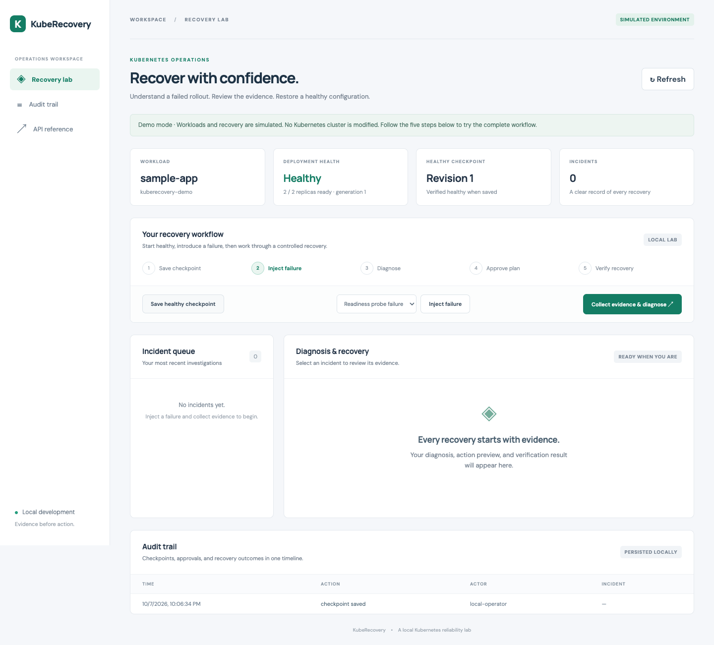
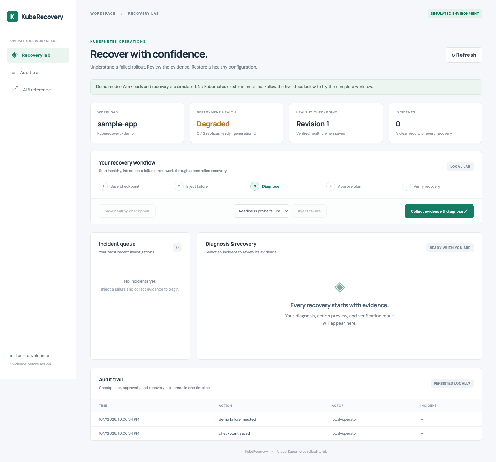
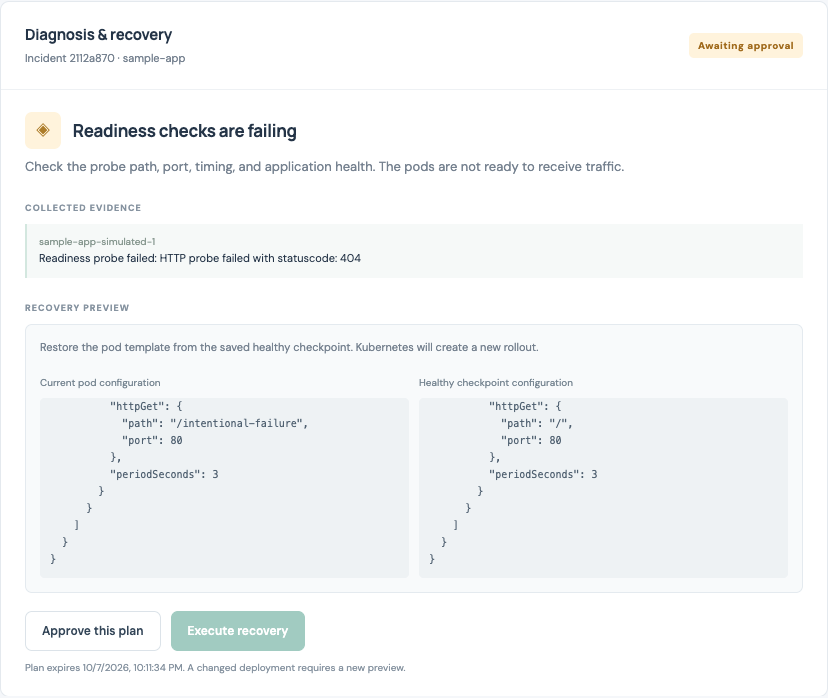
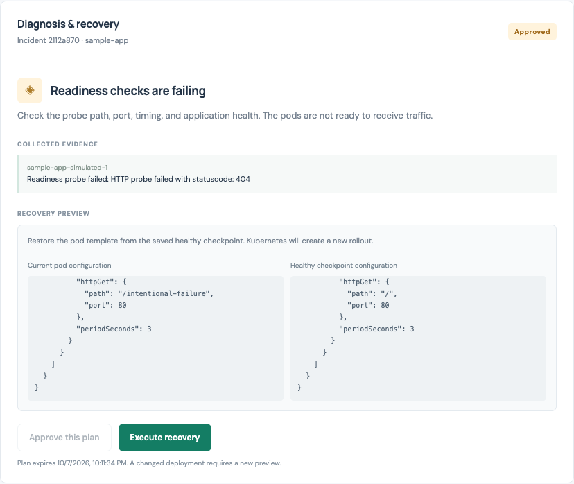
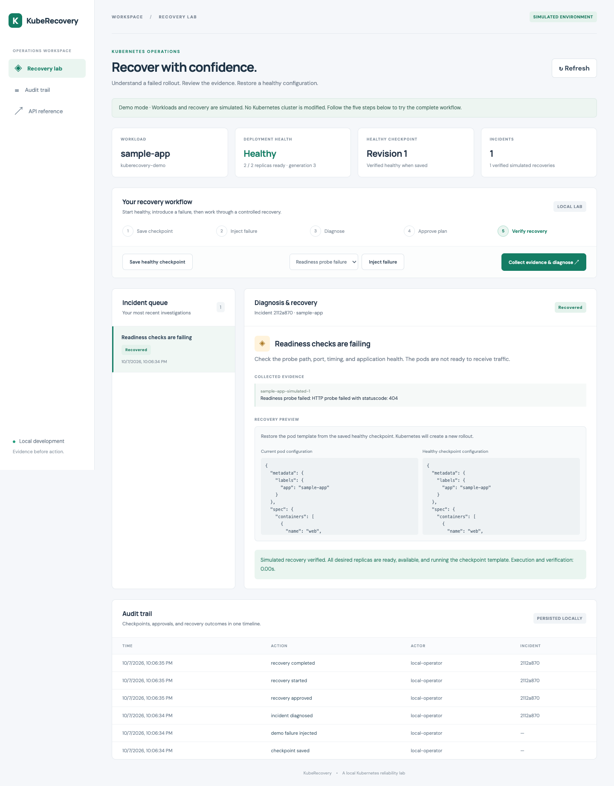
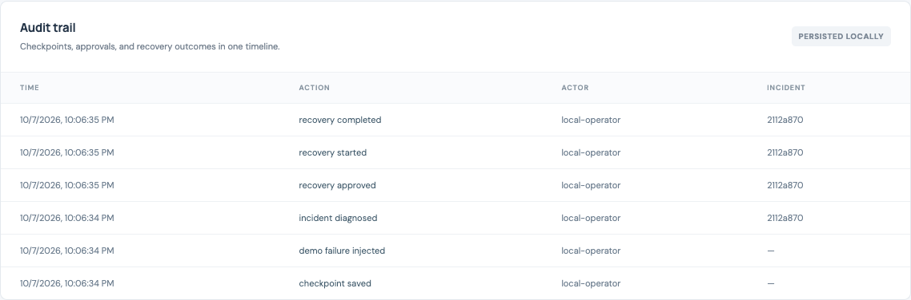

# KubeRecovery

A local Kubernetes operations lab that diagnoses a failed rollout, previews a recovery,
requires approval, restores a saved healthy pod template, and verifies the result.

Built to demonstrate backend engineering, Kubernetes troubleshooting, and controlled
operational automation. **Demo mode is fully simulated. Live mode is restricted to a
local cluster and the project's sample Deployment.**

## Try the demo

Requires Python 3.9+. No Docker, Kubernetes cluster, cloud account, or AI API key is needed.

```bash
git clone https://github.com/abarnasokan/kuberecovery.git
cd kuberecovery
python3 -m venv .venv
.venv/bin/python -m pip install --upgrade pip
.venv/bin/python -m pip install -e '.[dev]'
bash scripts/run.sh
```

For subsequent runs, use only `bash scripts/run.sh`.
Open **http://127.0.0.1:8080**. API documentation: `/docs`.

Follow the [step-by-step walkthrough with screenshots](#demo-walkthrough-with-screenshots)
below: save a checkpoint → inject a failure → diagnose → approve → recover → review the audit trail.

Try all three scenarios: readiness-probe failure, image-pull failure, and a container
crash loop. Each scenario uses the same lifecycle. Demo timings measure simulated
execution; they are not Kubernetes performance results.

Stop the server with Ctrl+C. State persists under `.data/demo/`. To start a new demo
without deleting history, set `KUBERECOVERY_DATA_DIR` to a fresh directory.

## Demo walkthrough with screenshots

This walkthrough uses **Readiness probe failure** in **demo mode**. It takes about
three minutes. The screenshots were captured from the running app in an isolated
demo; all workload changes and recovery results shown here are simulated.

Open **http://127.0.0.1:8080** and confirm the header says **SIMULATED ENVIRONMENT**.
If you already have incidents, they remain in the queue. To match the clean screenshots,
stop your existing server with Ctrl+C, choose a new data directory, and start again:

```bash
KUBERECOVERY_DATA_DIR=.data/walkthrough-01 bash scripts/run.sh demo
```

Reusing that directory preserves its history. Choose a different directory name for
another clean walkthrough. If port 8080 is occupied, stop the existing server or use
`PORT=8082` and open http://127.0.0.1:8082 instead.

### 1. Save a healthy checkpoint

Click **Save healthy checkpoint**. This records the configuration that recovery will
restore later. A checkpoint can only be saved while the deployment is fully healthy.

**Check:** Deployment health reads **Healthy**, **2 / 2 replicas ready**, and Healthy
checkpoint shows **Revision 1** in a fresh demo. **Inject failure** becomes enabled.



### 2. Introduce a readiness-probe failure

Choose **Readiness probe failure** in the dropdown, then click **Inject failure**.
The simulation changes the probe path from `/` to `/intentional-failure`, which
returns an HTTP 404 in the simulated evidence.

**Check:** Health changes to **Degraded**, with **0 / 2 replicas ready**. The healthy
checkpoint remains saved. No incident exists until you collect evidence.



### 3. Collect evidence and review the recovery preview

Click **Collect evidence & diagnose**. An incident appears in the queue, and the
diagnosis panel explains **Readiness checks are failing**.

Read the collected evidence: `Readiness probe failed: HTTP probe failed with
statuscode: 404`. Compare the current and healthy checkpoint configurations. Scroll
inside the configuration panels to find `readinessProbe.httpGet.path`: the current
path is `/intentional-failure`, and the checkpoint path is `/`.

**Check:** The incident says **Awaiting approval**. **Approve this plan** is enabled;
**Execute recovery** is disabled. Collecting evidence does not change the deployment.



### 4. Approve the exact recovery plan

After reviewing the preview, click **Approve this plan**. Approval applies to this
stored plan; the recovery will restore the entire checkpoint pod template.

**Check:** The incident changes to **Approved**, and **Execute recovery** becomes
enabled. Health remains degraded because approval alone does not perform recovery.

The plan expires five minutes after diagnosis. If it expires, collect evidence again
to create a new incident and approve its fresh plan. This local lab uses one operator;
the approval step does not require a separate person.



### 5. Execute recovery and verify the result

Click **Execute recovery**. The service restores the checkpoint template and checks
that the deployment has completed its rollout and all desired replicas are ready
and available.

**Check:** The incident becomes **Recovered**, health returns to **Healthy**, and
the result says **Simulated recovery verified**. The checkpoint still identifies
the saved revision; the deployment generation advances as the simulated changes occur.

The displayed execution time is a simulation measurement, not a real Kubernetes
recovery benchmark. In live mode, the same action patches the sample Deployment and
waits for real rollout health checks.



### 6. Review the audit trail

Scroll down to **Audit trail**, or click **Audit trail** in the sidebar. The most
recent action appears first. Read upward from the oldest row to follow the lifecycle:

`checkpoint saved → demo failure injected → incident diagnosed → recovery approved
→ recovery started → recovery completed`

**Check:** The incident-related rows share the same incident ID. The actor is
`local-operator`, and the history remains after restarting the server.



### Repeat with the other failures

Once health is **Healthy**, save another checkpoint and repeat steps 2–6 using
**Image pull failure** or **Container crash loop**. Expect **Container image cannot
be pulled** or **Container repeatedly exits**, respectively. The crash-loop scenario
also shows previous-container logs. You can click earlier incidents to review their
original evidence and results.

### Regenerate the README screenshots

With the optional browser dependency installed (see [Validate](#validate)), run:

```bash
.venv/bin/python scripts/browser_smoke.py --walkthrough
```

The script starts a temporary demo on port 8091, exercises all three scenarios, and
saves these six readiness-probe screenshots under `docs/images/demo/`. It preserves
your normal demo state and stops its temporary server afterward. Include the PNGs
alongside the README when publishing the repository so the relative image links work.

## Run against a local Kubernetes cluster

Requires a running Docker engine, kubectl, and either kind or Docker Desktop Kubernetes.
The backend stays on your laptop; the sample workload runs in Kubernetes.

For kind, install it using the [official installation instructions](https://kind.sigs.k8s.io/docs/user/quick-start/), then:

```bash
kind create cluster --config k8s/kind.yaml
.venv/bin/python scripts/lab.py setup --context kind-kuberecovery
bash scripts/run.sh live
```

Alternatively, enable Kubernetes in Docker Desktop and use:

```bash
.venv/bin/python scripts/lab.py setup --context docker-desktop
bash scripts/run.sh live
```

`setup` creates the `kuberecovery-demo` namespace, a two-replica nginx Deployment,
Service, ServiceAccount, Role, and RoleBinding. It waits for the initial rollout and
writes a restricted kubeconfig and a separate operator API token under `.data/live/`
with private file permissions. It requests a one-hour Kubernetes token lifetime; the
cluster may choose a different actual lifetime. Rerunning setup renews credentials
and reapplies the healthy sample manifest, so do it between experiments and restart
the backend afterward.

Read the token locally with `cat .data/live/api-token` and paste it into the dashboard's
token field. The token stays in browser memory and is cleared from the input; it is
not stored in browser storage. Save a healthy checkpoint in the dashboard.

In another terminal, deliberately break the sample app:

```bash
.venv/bin/python scripts/lab.py inject readiness_probe --context kind-kuberecovery
# Other scenarios: image_pull or crash_loop
kubectl --context kind-kuberecovery -n kuberecovery-demo get pods
```

For Docker Desktop, replace the context with `docker-desktop`. Wait for the relevant
failure to appear, then click Refresh and run the diagnosis/approval/recovery flow.
The failed rollout can leave healthy old replicas serving traffic because
`maxUnavailable: 0`; the dashboard still reports it degraded until the new rollout
completes. A fresh failure can take time to enter `CrashLoopBackOff` or `ImagePullBackOff`.

Readiness is one signal of application health. This lab's checkpoint demonstrates
a successful Kubernetes rollout, not business-level correctness.

To view the sample application, use `kubectl --context kind-kuberecovery -n
kuberecovery-demo port-forward service/sample-app 8081:80` and open http://127.0.0.1:8081.

## What is implemented

- FastAPI API and responsive plain JavaScript dashboard.
- Deterministic evidence-based diagnosis for three failure patterns; ambiguous failures
  remain unknown. No model inference is used yet.
- A healthy checkpoint tied to deployment UID and explicit cluster context.
- Immutable recovery preview, exact-plan approval, and a five-minute expiry measured
  from preview creation.
- Atomic JSON Patch preconditions on UID, generation, and pod template before restoration.
- Health verification requiring observed generation, updated/ready/available replicas,
  no extra old replicas, and a matching checkpoint template.
- SQLite incident history and audit entries committed with lifecycle transitions.
- Idempotent incident creation by request key and duplicate-execution suppression.
- Interrupted or inconclusive executions become `verification_required`; they are never
  automatically replayed.
- Live bearer-token authentication, same-origin mutation checks, local host restrictions,
  explicit local cluster endpoints, and verification of the lab ServiceAccount identity.
- Kubernetes RBAC permitting `get`/`patch` only on `sample-app` and reading pods,
  ReplicaSets, events, and logs in `kuberecovery-demo`.

The recovery replaces the entire pod template with the checkpoint's template. It
does not change Deployment replicas, selectors, or Services. Kubernetes creates a
new revision; the revision number is not reset to the checkpoint revision.

## Validate

```bash
.venv/bin/python -m pytest -q
.venv/bin/ruff check backend tests scripts
.venv/bin/ruff format --check backend tests scripts
node --check web/app.js
```

Optional dashboard checks (using installed Chrome on macOS, or Playwright Chromium):

```bash
.venv/bin/python -m pip install -e '.[browser]'
# If Chrome is not installed: .venv/bin/python -m playwright install chromium
.venv/bin/python scripts/browser_smoke.py
```

This starts an isolated demo on port 8091 and saves screenshots under `.data/browser-qa/`.
For a different installed browser, set `BROWSER_EXECUTABLE` to its executable path.

To repeat the real-cluster experiment, stop any live backend first, then run:

```bash
.venv/bin/python scripts/live_smoke.py --context docker-desktop
```

This deliberately breaks and recovers the sample Deployment three times and records
results in `.data/live/verification.json`. Use `kind-kuberecovery` for kind instead.

Tests cover each simulated failure, auth, stale and expired approvals, concurrent
duplicate requests, checkpoint identity, startup recovery, and atomic patch construction.
Adapter tests mock Kubernetes responses. A passing unit suite does not verify a live cluster.

The initial implementation also passed all three real-cluster recovery scenarios on
Docker Desktop and all three dashboard flows in Chrome. See [docs/verification.md](docs/verification.md)
for the observed results and their limits.

## Project layout

```text
backend/kuberecovery/
  domain.py      Pure diagnosis and recovery-plan rules
  adapters.py    Simulated cluster and scoped kubectl adapter
  service.py     Incident lifecycle, approval, execution, verification
  store.py       SQLite persistence and audit log
  app.py         HTTP routes, authentication, dashboard serving
web/             Dashboard HTML, CSS, and JavaScript
k8s/             Sample workload, RBAC, and kind cluster configuration
scripts/         Local launcher and deliberate-failure CLI
tests/           Lifecycle, API, concurrency, and adapter tests
docs/            Architecture, walkthrough, and next milestones
```

## Current limits and next milestones

This is a local portfolio lab with one operator and one server worker. The approval
step records operator intent; it does not enforce approval by a different person.
The audit log is locally editable SQLite, not a tamper-evident compliance system.
Never run multiple workers or separate server instances against the same data directory.
There is no queue, distributed lock, Prometheus integration, AI explanation, or EKS
deployment yet. Logs can contain application data; collection is restricted to the
sample app. The launcher binds to loopback; keep it local.

Next milestones and a live verification checklist are in [docs/roadmap.md](docs/roadmap.md).
See [docs/architecture.md](docs/architecture.md) for the reasoning behind the design.

References: [Kubernetes Deployments](https://kubernetes.io/docs/concepts/workloads/controllers/deployment/),
[readiness probes](https://kubernetes.io/docs/tasks/configure-pod-container/configure-liveness-readiness-startup-probes/),
[RBAC](https://kubernetes.io/docs/reference/access-authn-authz/rbac/),
[JSON Patch](https://datatracker.ietf.org/doc/html/rfc6902).
