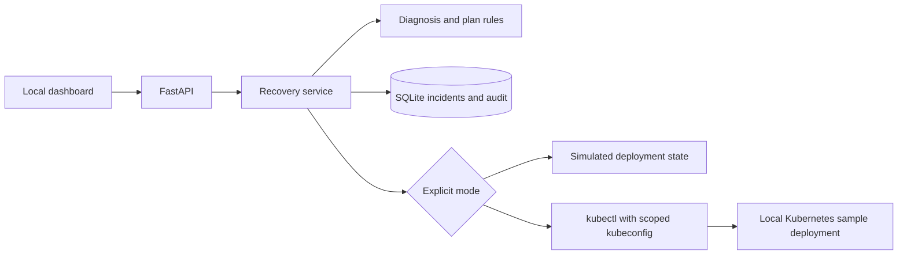
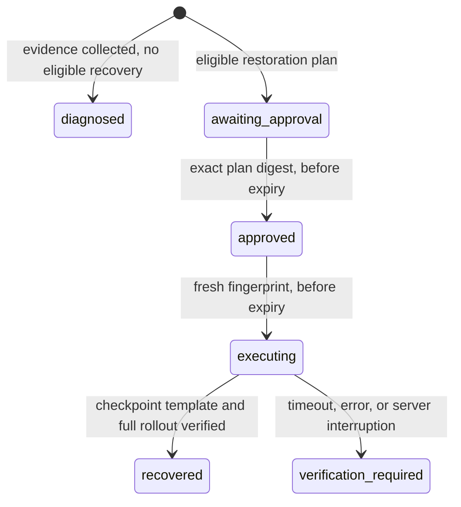

# Architecture and decisions

The initial scope is one known sample workload. This keeps diagnosis and remediation
reviewable while teaching Deployment generations, probes, pod events, RBAC, and rollout
verification. Adding arbitrary workloads before their recovery contracts are defined
would make an automated rollback harder to justify.

## Why a healthy checkpoint?

The previous Deployment revision is not necessarily healthy. The operator saves a
checkpoint only after a complete rollout. Its context and UID bind it to the exact
deployment. Deleting and recreating the Deployment invalidates the old checkpoint.

Checkpoint health is limited to Kubernetes readiness and rollout conditions. A future
version can add HTTP checks and application-level synthetic requests.

## Diagnosis is separate from recovery

ImagePullBackOff and CrashLoopBackOff identify observed symptoms. The explanation
lists possible causes instead of asserting a cause from insufficient evidence.
The incident retains its evidence snapshot even after the cluster changes. A supported
failure with a changed pod template and a matching healthy checkpoint can receive a
restoration plan. Unknown failures or failures on an unchanged template cannot.

## Approval and state transitions

The approved plan is stored on the server; requests cannot submit arbitrary patches.
A deployment fingerprint includes context, UID, generation, and template. Status-only
updates do not invalidate it. At mutation time the API server atomically tests UID,
generation, and template before replacing the template. This closes the race between
the earlier evidence read and patch application.

Expiry is five minutes from plan creation and is checked both at approval and execution.
There is one local operator identity, not independent requester/approver roles.

## Idempotency and uncertain outcomes

Incident creation uses a caller-generated key. Retrying the same key returns the same
incident. A single service lock serializes lifecycle transitions and cluster actions.
An execution is persisted before calling Kubernetes. Repeated execution requests return
the stored terminal result rather than patching again.

If the server crashes after sending a patch, it may not know whether Kubernetes
accepted it. On startup, any `executing` incident becomes `verification_required`.
The operator must inspect state. This is duplicate suppression for a single process,
not a claim of exactly-once delivery in a distributed system.

## Permissions and execution bounds

The live adapter uses an explicit kubeconfig, context, namespace, and deployment name.
Startup checks the ServiceAccount identity; the kubeconfig must point to a local HTTPS
endpoint with TLS verification enabled. RBAC constrains the only writable resource
to the sample Deployment. Reads are namespace-wide because pods and ReplicaSets have
generated names, then filtered by owner references.

Each kubectl call has a subprocess timeout and an API request timeout. The verification
polling window is bounded to 60 seconds including its reads. Evidence collection and
the patch have separate bounds, so total HTTP execution can take longer than 60 seconds.
Recovery does not claim success merely because a patch returned successfully.

## Storage and scaling tradeoffs

SQLite is sufficient for a local lab and makes incident/audit transitions transactional.
The audit log is not tamper-proof. Demo and live modes use separate databases. Process
locks are deliberately limited to one worker; a hosted version needs database-backed
work claims, persisted jobs, stronger authentication, and separate operator roles.
